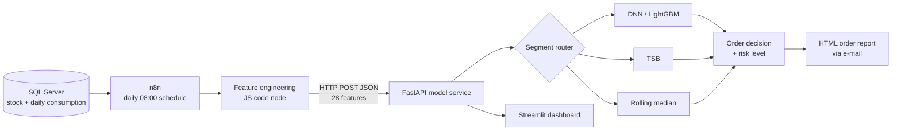

# Hospital Pharmacy Demand Forecasting

**A segment-based forecasting system that turns daily drug consumption into a ready-to-act purchase list — delivered to the pharmacist's inbox every morning.**

> Technical write-up of a project built across two courses — *YZM709 – AI Applications* and *YZM704 – Statistical Machine Learning* (AI Engineering MSc, İzmir Bakırçay University, 2026).
> The project ran on real hospital pharmacy consumption data, which **is not shared** here for confidentiality. This repository documents the architecture, modelling decisions and results.

---

## The problem
A hospital pharmacy manages thousands of drugs with very different demand patterns: some move every day, some a few times a month, some almost never. A single model fails on most of them. Pharmacists also don't need a forecast — they need to know **what to order today, and how much**.

## How the project evolved

### Phase 1 — 1.36M rows, 2,751 drugs, and a hidden data problem
The first attempt used 5.5 years of raw consumption data (1,357,825 rows) and trained SARIMA, LSTM, DNN, XGBoost, LightGBM, Random Forest and an ensemble on an A100 GPU (~15–20 hours). The best validation MAE was **7.04** — and SARIMA's was 73.9.

The root cause wasn't the models: consumption was recorded in **mixed units (tablets, ml, mg)**, which distorted every metric 10–40×.

### Phase 2 — clean data first
Restricting to a single unit (221 drugs, ~89K rows) brought the best MAE from **7.04 to 1.89** and training time from ~15–20 hours to ~2 hours. Bayesian Online Changepoint Detection (BOCD) was added to handle structural breaks.

### Experiment — therapeutic group signal, and catching leakage
When a hospital switches to a generic equivalent, the old barcode's demand drops and the new one starts from zero; a per-drug model sees two unrelated drugs. To capture group-level demand, every drug was matched to its **ATC code** via the public national drug list (100% match), and an `ATC_L2_demand` feature was added.

| LightGBM | Val MAE | Test MAE |
|---|---|---|
| Baseline | 1.907 | 1.942 |
| + ATC group demand | 1.760 | 1.777 |
| + ATC group demand, **leave-one-out** | 1.886 | 1.926 |

The group feature included the target drug's own demand. A **leave-one-out** version showed that most of the apparent 7.7% gain came from **target leakage**; the real gain is ~1.1%. Production uses the leakage-free version.

### Experiment — quantile regression for uncertainty
LightGBM quantile models (Q10/Q50/Q90) produce an 80% prediction interval instead of a single number. Coverage was **79.2% (val) / 78.9% (test)** against an 80% target — well calibrated — and the interval widens automatically around structural breaks. *Note: these models were trained with the group feature before the leakage analysis, so their point accuracy is likely somewhat optimistic.*

## The approach: route every drug to the model that fits its demand
Drugs are classified by demand density and history, and each segment gets its own method:

| Segment | Demand pattern | Method | Val MAE (boxes/day) |
|---|---|---|---|
| Main – oral | High density | **DNN + LightGBM stacking** | 0.437 |
| Main – parenteral | High volatility | **DNN v6 with Huber loss** | 2.100 |
| Intermittent | 10–60% of days | **TSB (Teunter–Syntetos–Babai)** | 1.174 |
| Low density | < 10% of days | Rolling median | 2.478 |
| Cold start | < 90 active days | ATC-group average | — |
| Obsolete | No movement > 365 days | Monitored, not forecast | — |

The segment of each drug is precomputed into a lookup table, so the API routes requests automatically.

## Architecture

**Stack:** n8n (self-hosted, Docker) · FastAPI + uvicorn · TensorFlow/Keras · LightGBM · scikit-learn · SQL Server · Streamlit · SMTP

## Key engineering decisions
- **Box-based normalization.** Consumption is recorded in tablets/ampoules, but orders are placed in boxes. All targets and lag features are divided by pack size, so the model learns in the unit the pharmacist orders in.
- **Cyclic calendar features.** Month and weekday are encoded with sin/cos so December–January and Sunday–Monday are close to each other.
- **No train–serving skew.** The exact scalers fitted during training are persisted and reused at inference.
- **Features computed in the pipeline.** n8n computes lags (1/7/14/30 days) and rolling mean/median/std before calling the API, keeping the model service stateless.
- **Forecast → decision.** `order = 60-day forecast + 15% safety stock − current stock`, plus a risk label:

| Risk | Condition |
|---|---|
| CRITICAL | Stock = 0 |
| WARNING | Stock < safety stock |
| NORMAL | Stock < 2 × safety stock |
| SUFFICIENT | Stock ≥ 2 × safety stock |

## Results

### Model comparison (phase 2, clean data)
| Model | Val MAE | Test MAE |
|---|---|---|
| SARIMA | 4.525 | 5.052 |
| BOCD | 4.459 | 4.854 |
| LSTM | 2.399 | 2.288 |
| DNN | 1.938 | 1.994 |
| XGBoost | 1.916 | 1.957 |
| LightGBM | 1.907 | 1.942 |
| Random Forest | 1.891 | 1.929 |
| **LightGBM Quantile (Q50)** | **1.704** | **1.681** |

*Q50 includes the pre-LOO group feature (see above).* Classical time-series models (SARIMA, BOCD) were clearly beaten by feature-based ML. Close scores across ML models with different error patterns motivated stacking; the quantile model's robustness to outliers motivated the Huber loss used later for volatile drugs.

### Parenteral drugs: from 534% to 23% MAPE
| Version | Change | Val MAPE | Val WAPE |
|---|---|---|---|
| v1 | Raw DNN baseline | 534% | — |
| v3 | Log normalization | 49.7% | 49.7% |
| v5 | Per-drug target normalization | 50.4% | 50.4% |
| **v6** | **Dynamic IQR outlier capping + Huber loss (δ=0.5)** | **23.3%** | **14.6%** |

WAPE (14.6%) weights errors by volume, which matters more for pharmacy spend than per-drug MAPE.

### In production
- Runs every morning at 08:00 for the active drug list (~221 drugs), in **45–60 seconds on CPU**
- In a live run, **41 drugs** were automatically flagged with an order quantity and risk level and e-mailed to the pharmacy

## What I would do next
- Replace the fixed 15% safety stock with the quantile margin (Q90 − Q50), retrained on the leakage-free feature
- Forecast at ATC-group level and distribute to individual drugs (handles generic switches)
- Supplier lead times and minimum order quantities in the order formula
- Drift monitoring and scheduled retraining

## References
- Teunter, Syntetos & Babai (2011). *Intermittent demand forecasting: An empirical comparison.*
- Huber (1964). *Robust Estimation of a Location Parameter.*
- Ke et al. (2017). *LightGBM: A Highly Efficient Gradient Boosting Decision Tree.*
- Killick, Fearnhead & Eckley (2012). *Optimal Detection of Changepoints with a Linear Computational Cost.*
